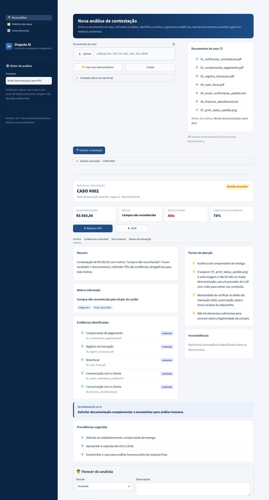

# 🛡️ Dispute AI

**Assistente inteligente para análise de contestações e chargebacks.**

Empresas de meios de pagamento recebem contestações de transações feitas com cartão. Para cada uma, é preciso analisar documentos, identificar o motivo, verificar as evidências e organizar as informações que vão subsidiar a resposta. O Dispute AI automatiza essa triagem e entrega uma **análise preliminar** para um analista humano revisar.



## Funcionalidades

| # | Funcionalidade | Como funciona |
|---|----------------|---------------|
| 1 | **Upload de documentos** | PDF, TXT, e-mail (`.eml`) e imagens (PNG, JPG, WEBP), vários arquivos por caso |
| 2 | **Extração de informações** | Texto dos PDFs com PyMuPDF. Páginas digitalizadas e imagens são lidas pelo LLM com visão. Nos e-mails, cabeçalhos, corpo e anexos são aproveitados |
| 3 | **Motivo da contestação** | Classificação em 7 categorias (compra não reconhecida, não recebido, divergente, cancelamento, duplicidade, valor incorreto, outro), com código de motivo e prazo |
| 4 | **Organização das evidências** | Cada documento é classificado por tipo, e as evidências recebem uma força (forte, moderada ou fraca) |
| 5 | **Documentos ausentes** | Um checklist determinístico por motivo aponta os documentos obrigatórios e recomendados que faltam |
| 6 | **Relatório** | Status, risco, pontos de atenção, inconsistências, recomendação e providências, em tela, **PDF** e JSON |
| + | **Histórico de casos** | Casos salvos em SQLite com filtros, reabertura, parecer do analista e exclusão |
| + | **Vários provedores de LLM** | Anthropic (Claude), OpenAI (GPT) ou Google Gemini, escolhidos na barra lateral |
| + | **Modo demonstração** | Análise por regras, sem chave de API. Também serve de contingência se a API falhar |

## Tecnologias

Python 3.10+ · Streamlit · PyMuPDF · SQLite · APIs de LLM (Anthropic, OpenAI, Google Gemini)

## Instalação

```bash
git clone https://github.com/RaissaAbreu/Dispute-AI.git
cd Dispute-AI
python -m venv .venv
source .venv/bin/activate        # Windows: .venv\Scripts\activate
pip install -r requirements.txt
```

### Configurar as chaves de API (opcional)

```bash
cp .env.example .env
```

Preencha no `.env` a chave do provedor que for usar (`ANTHROPIC_API_KEY`, `OPENAI_API_KEY` ou `GEMINI_API_KEY`). Também dá para colar a chave direto na barra lateral; nesse caso ela fica só na sessão. **Sem nenhuma chave, o sistema funciona em modo demonstração.**

## Execução

```bash
streamlit run app.py
```

Acesse http://localhost:8501, clique em **"Usar caso demonstrativo"** e depois em **"Analisar contestação"**.

## Caso demonstrativo

A pasta `exemplos/` traz documentos **fictícios** de uma venda de **R$ 850,00** contestada por *compra não reconhecida*:

| Arquivo | Conteúdo |
|---------|----------|
| `01_notificacao_contestacao.pdf` | Aviso do adquirente: motivo 10.4 e prazo de defesa |
| `02_comprovante_pagamento.pdf` | Comprovante (via do cliente) |
| `03_registro_transacao.pdf` | Log do gateway: NSU, autorização, IP e 3DS não realizado |
| `04_nota_fiscal.pdf` | DANFE da venda |
| `05_email_confirmacao_pedido.eml` | E-mail de confirmação do pedido |
| `06_historico_atendimento.txt` | Tentativas de contato com o cliente |
| `07_print_status_pedido.png` | Captura de tela: pedido "em trânsito" (só é lida com LLM) |

O conjunto **não traz o comprovante de entrega** de propósito. Com isso, o resultado esperado é:

> **CASO #001 · Revisão necessária** · Valor: R$ 850,00 · Motivo: Compra não reconhecida
> **Pontos de atenção:** ausência de comprovante de entrega; necessidade de verificar os dados da transação; não há elementos suficientes para concluir sobre a legitimidade da compra.
> **Recomendação da IA:** solicitar documentação complementar e encaminhar para análise humana.

Para gerar os documentos de novo:

```bash
python scripts/gerar_exemplos.py
```

## Estrutura do projeto

```
Dispute-AI/
├── app.py                      # Entrada da aplicação Streamlit (navegação + barra lateral)
├── dispute_ai/
│   ├── config.py               # Provedores, modelos, limites e caminhos
│   ├── catalogo.py             # Tipos de documento, motivos e checklist de evidências
│   ├── extracao.py             # Leitura de PDF (PyMuPDF), TXT, EML e imagens
│   ├── analisador.py           # Orquestração: LLM/regras + checklist + normalização
│   ├── regras.py               # Modo demonstração (regex e palavras-chave)
│   ├── banco.py                # Persistência SQLite (casos e documentos)
│   ├── relatorio.py            # Relatório em PDF (PyMuPDF Story)
│   ├── formatacao.py           # Moeda, datas e rótulos em PT-BR
│   ├── llm/
│   │   ├── base.py             # Integração com Anthropic, OpenAI e Gemini
│   │   └── prompts.py          # Prompt do sistema e esquema JSON da resposta
│   └── ui/
│       ├── estilos.py          # Tema corporativo azul-escuro
│       ├── componentes.py      # Cartões, relatório em abas e parecer do analista
│       └── paginas.py          # Nova análise, Histórico e Como funciona
├── scripts/gerar_exemplos.py   # Gera os documentos fictícios
├── exemplos/                   # Caso demonstrativo (R$ 850,00)
├── tests/                      # Testes automatizados (pytest)
├── .streamlit/config.toml      # Tema e configurações do Streamlit
├── .env.example                # Modelo de variáveis de ambiente
└── requirements.txt
```

## Como a análise é feita

1. **Extração**: o PyMuPDF lê o texto. Páginas com pouco texto (digitalizadas) viram imagem e vão para o LLM.
2. **LLM**: o modelo recebe todos os documentos e um prompt com o catálogo de tipos, os motivos e o checklist, e devolve um **JSON estruturado**.
3. **Regras determinísticas**: o checklist por motivo é recalculado no código. O status **nunca** fica como "Evidências suficientes" se faltar um documento obrigatório ou houver inconsistências.
4. **Persistência**: análise, documentos originais e texto extraído vão para o SQLite (`data/dispute_ai.db`).
5. **Revisão humana**: o analista registra sua decisão (defender, aceitar, aguardar documentos) e observações, que também aparecem no PDF.

## Testes

```bash
pytest
```

## Avisos

- Use **apenas documentos fictícios ou anonimizados**. Com um provedor de LLM, o conteúdo dos documentos é enviado à API desse provedor.
- O resultado é uma **análise preliminar de apoio** e não substitui a avaliação de um analista humano.
- Os nomes de modelo da barra lateral podem ser trocados pela opção "Outro (digitar)…", conforme os modelos disponíveis na sua conta.
